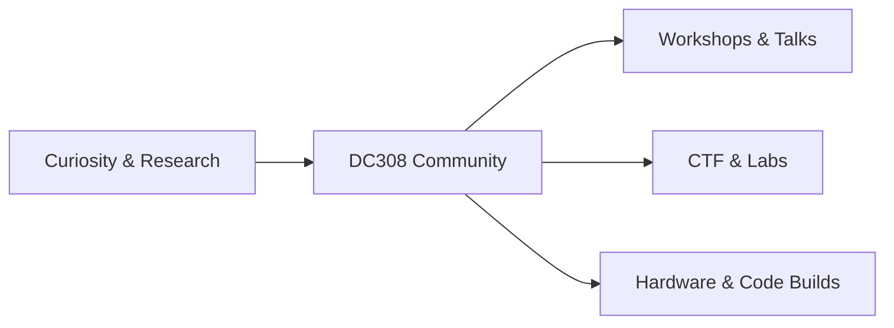

Welcome to **DEFCON 308 (DC308)**!

We are the DEFCON Group serving Western Nebraska across the 308 area code. Whether you're interested in offensive security, blue team defense, hardware hacking, radio/mesh networks (Meshtastic/LoRa), reverse engineering, or local AI systems, this group is for you.

## Getting Started

DEFCON Groups are free, community-driven, and open to anyone who wants to learn, share, and build. 

*DC308 community loop: curiosity to collaboration.*

## Stay Connected

- **GitHub:** Check out our open-source tools and repositories at [github.com/DC308-COM](https://github.com/DC308-COM).
- **Email:** Drop a line to [toor@dc308.com](mailto:toor@dc308.com).

More announcements, meeting schedules, and project write-ups coming soon!
